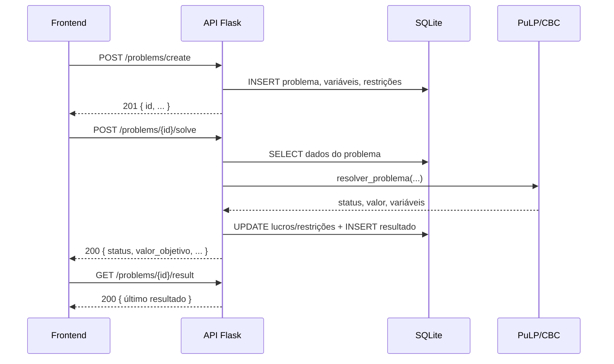

# API REST

## Base URL

```text
http://127.0.0.1:5000
```

O backend usa **Flask** com **Flask-CORS**. O frontend acessa a API por
`http://127.0.0.1:5000`.

!!! info "Sem autenticação"

    Todas as rotas são públicas e não exigem token, sessão ou cabeçalho de
    autenticação. O CORS está aberto para qualquer origem. Isso é adequado para
    a demonstração local, mas não para produção.

## Endpoints

| Método | Rota | Descrição |
|---|---|---|
| `GET` | `/problems` | Lista todos os problemas. |
| `POST` | `/problems/create` | Cria um problema completo. |
| `GET` | `/problems/{id}` | Detalha um problema, suas variáveis e restrições. |
| `DELETE` | `/problems/{id}` | Exclui o problema e seus dados relacionados. |
| `POST` | `/problems/{id}/solve` | Resolve o problema com PuLP/CBC. |
| `GET` | `/problems/{id}/result` | Retorna o último resultado salvo. |

!!! note "Não há rota de edição"

    O fluxo atual permite criar, consultar, resolver e excluir. Não existe
    `PUT /problems/{id}`; para alterar um problema, o usuário deve criar outro.

## Listar problemas

```http
GET /problems
```

Resposta:

```json
[
  {
    "data_criacao": "2026-06-18",
    "id": 1,
    "nome": "Maximização da Empresa de TI",
    "objetivo": "maximize",
    "resolvido": true
  }
]
```

## Contrato de criação

`POST /problems/create` recebe um objeto JSON com os campos abaixo.

| Campo | Tipo | Obrigatório | Observação |
|---|---|---|---|
| `nome` | string | Sim | Nome exibido na lista. |
| `objetivo` | string | Sim | `maximize` ou `minimize`. |
| `variaveis` | array | Sim | Pelo menos uma variável. |
| `variaveis[].nome` | string | Sim | Nome da variável. |
| `variaveis[].coeficiente_objetivo` | number | Sim | Coeficiente na função objetivo. |
| `variaveis[].unidade_medida` | string | Não | Se ausente, o backend grava string vazia. |
| `restricoes` | array | Sim | Pelo menos uma restrição. |
| `restricoes[].nome` | string | Sim | Nome da restrição. |
| `restricoes[].operador` | string | Sim | `<=`, `>=` ou `=`. |
| `restricoes[].limite` | number | Sim | Lado direito da restrição. |
| `restricoes[].coeficientes` | number[] | Sim | Um coeficiente por variável, na ordem do array `variaveis`. |

!!! note "`data_criacao` é ignorado"

    O frontend envia `data_criacao`, mas o backend usa `date.today()` para
    gravar a data. O campo não é obrigatório.

## Criar problema

```http
POST /problems/create
Content-Type: application/json
```

Exemplo com a demo rápida:

```json
{
  "nome": "Demo Rápida",
  "objetivo": "maximize",
  "variaveis": [
    {
      "nome": "Sites",
      "coeficiente_objetivo": 3000,
      "unidade_medida": "projetos"
    },
    {
      "nome": "Apps",
      "coeficiente_objetivo": 2000,
      "unidade_medida": "projetos"
    }
  ],
  "restricoes": [
    {
      "nome": "Capacidade da equipe",
      "operador": "<=",
      "limite": 10,
      "coeficientes": [1, 1]
    },
    {
      "nome": "Horas de desenvolvimento",
      "operador": "<=",
      "limite": 16,
      "coeficientes": [2, 1]
    }
  ]
}
```

Resposta `201 Created`:

```json
{
  "id": 2,
  "nome": "Demo Rápida",
  "objetivo": "maximize",
  "resolvido": false,
  "data_criacao": "2026-10-22",
  "variaveis": [
    {
      "id": 6,
      "nome": "Sites",
      "coeficiente_objetivo": 3000.0,
      "unidade_medida": "projetos",
      "lucro": 0.0
    },
    {
      "id": 7,
      "nome": "Apps",
      "coeficiente_objetivo": 2000.0,
      "unidade_medida": "projetos",
      "lucro": 0.0
    }
  ],
  "restricoes": [
    {
      "id": 4,
      "nome": "Capacidade da equipe",
      "operador": "<=",
      "limite": 10.0,
      "atendida": null,
      "coeficientes": [
        { "variavel_id": 6, "valor": 1.0 },
        { "variavel_id": 7, "valor": 1.0 }
      ]
    },
    {
      "id": 5,
      "nome": "Horas de desenvolvimento",
      "operador": "<=",
      "limite": 16.0,
      "atendida": null,
      "coeficientes": [
        { "variavel_id": 6, "valor": 2.0 },
        { "variavel_id": 7, "valor": 1.0 }
      ]
    }
  ]
}
```

!!! warning "Ordem dos coeficientes"

    A lista `coeficientes` de cada restrição deve ter **um valor para cada
    variável**, na mesma ordem em que as variáveis foram enviadas.

## Detalhar problema

```http
GET /problems/{id}
```

Retorna os dados do problema, incluindo `variaveis` e `restricoes`.

## Resolver problema

```http
POST /problems/{id}/solve
```

O corpo da requisição é ignorado: o backend usa apenas o `id` da URL e os dados
já persistidos. O frontend envia a resposta da criação por conveniência, mas ela
não é necessária.

Resposta para a demo:

```json
{
  "status": "Optimal",
  "valor_objetivo": 26000.0,
  "variaveis": {
    "Sites": 6.0,
    "Apps": 4.0
  },
  "restricoes": [
    {
      "id": 4,
      "nome": "Capacidade da equipe",
      "operador": "<=",
      "limite": 10.0,
      "uso": 10.0,
      "folga": 0.0,
      "atendida": true
    },
    {
      "id": 5,
      "nome": "Horas de desenvolvimento",
      "operador": "<=",
      "limite": 16.0,
      "uso": 16.0,
      "folga": 0.0,
      "atendida": true
    }
  ]
}
```

Possíveis status:

| Status | Significado |
|---|---|
| `Optimal` | Solução ótima encontrada. |
| `Infeasible` | As restrições são conflitantes. |
| `Unbounded` | A função objetivo cresce ou decresce sem limite. |
| `Not Solved` | O solver não chegou a uma solução. |

## Consultar resultado

```http
GET /problems/{id}/result
```

Retorna o último resultado salvo, com `status`, `valor_objetivo`, `variaveis` e
`restricoes`. Se o problema ainda não foi resolvido, retorna `404`.

## Excluir problema

```http
DELETE /problems/{id}
```

Resposta:

```json
{
  "mensagem": "Problema removido com sucesso"
}
```

A exclusão remove, em cascata manual:

- coeficientes das restrições;
- restrições;
- variáveis;
- resultados;
- problema.

## Códigos de erro

| Código | Situação |
|---|---|
| `200` | Consulta, resolução ou exclusão concluída. |
| `201` | Problema criado. |
| `400` | Campo obrigatório ausente, objetivo inválido, operador inválido, lista vazia ou quantidade de coeficientes incorreta. |
| `404` | Problema não encontrado ou resultado ainda não disponível. |
| `500` | Erro interno, como falha de banco, JSON malformado ou inconsistência nos dados. |

Formato dos erros de validação e de recurso não encontrado:

```json
{
  "erro": "Campo 'nome' é obrigatório"
}
```

```json
{
  "erro": "Problema não encontrado"
}
```

A consulta de resultado sem resolução retorna uma mensagem, não um erro:

```json
{
  "mensagem": "Nenhum resultado encontrado"
}
```

## Fluxo típico do frontend



## Exemplos com cURL

**Criar:**

```bash
curl -X POST http://127.0.0.1:5000/problems/create \
  -H "Content-Type: application/json" \
  -d '{
    "nome": "Demo Rápida",
    "objetivo": "maximize",
    "variaveis": [
      {"nome": "Sites", "coeficiente_objetivo": 3000, "unidade_medida": "projetos"},
      {"nome": "Apps", "coeficiente_objetivo": 2000, "unidade_medida": "projetos"}
    ],
    "restricoes": [
      {"nome": "Capacidade da equipe", "operador": "<=", "limite": 10, "coeficientes": [1, 1]},
      {"nome": "Horas de desenvolvimento", "operador": "<=", "limite": 16, "coeficientes": [2, 1]}
    ]
  }'
```

**Listar:**

```bash
curl http://127.0.0.1:5000/problems
```

**Detalhar:**

```bash
curl http://127.0.0.1:5000/problems/1
```

**Resolver:**

```bash
curl -X POST http://127.0.0.1:5000/problems/1/solve
```

**Resultado:**

```bash
curl http://127.0.0.1:5000/problems/1/result
```

**Excluir:**

```bash
curl -X DELETE http://127.0.0.1:5000/problems/2
```
