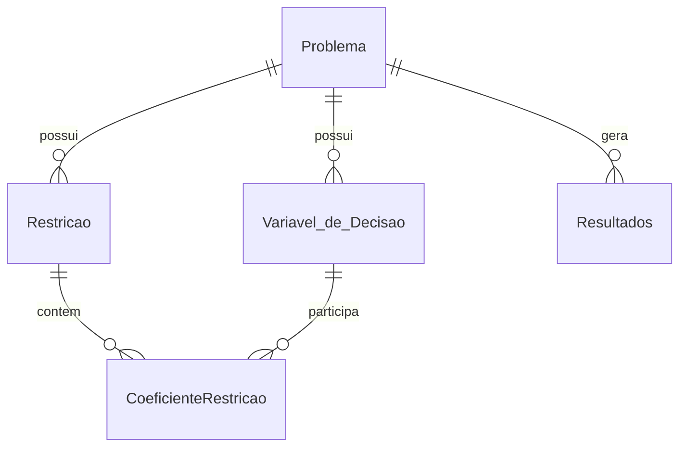

# Backend e banco de dados

## Visão geral

O backend é uma API REST em **Flask** que persiste problemas no **SQLite** e
resolve o modelo com **PuLP + CBC**. Ele não renderiza HTML: responde JSON para
o frontend React.

O código fica em:

```text
backend/
```

## Tecnologias

| Tecnologia | Uso no projeto |
|---|---|
| **Flask 3** | Rotas HTTP e blueprints. |
| **Flask-CORS** | Libera o acesso do frontend em outra porta. |
| **SQLAlchemy 2** | Mapeamento ORM e sessão por thread. |
| **SQLite** | Banco local versionado para a demonstração. |
| **PuLP 3** | Modelagem do problema de Programação Linear. |
| **CBC** | Solver chamado pelo PuLP. |

## Estrutura

```text
backend/
├── README.md
├── app.py              # cria o Flask, CORS, blueprints e teardown
├── run.py              # launcher usado pelos scripts de inicialização
├── database.py         # engine SQLite e scoped_session
├── models.py           # cinco tabelas e criação do schema
├── solver.py           # monta o modelo PuLP e chama o CBC
├── routes/
│   ├── problems.py     # listar, detalhar, criar e excluir
│   └── results.py      # resolver e consultar o último resultado
├── requirements.txt
├── db.sqlite3          # banco da demonstração
├── db.sqlite3.backup   # cópia para restaurar
├── api-tester.html     # página manual para testar as rotas
└── arquivo/            # protótipos antigos
```

## Inicialização

`app.py`:

1. cria a instância `Flask(__name__)`;
2. habilita `CORS(app)` para todas as origens;
3. registra os blueprints `problems_bp` e `result_bp`;
4. registra `teardown_appcontext` para remover a sessão ao fim da requisição.

```python
app = Flask(__name__)
CORS(app)
app.register_blueprint(problems_bp)
app.register_blueprint(result_bp)

@app.teardown_appcontext
def remove_session(exception=None):
    session.remove()

if __name__ == "__main__":
    app.run(debug=True)
```

!!! info "Caminho do banco"

    O engine calcula o caminho absoluto de `db.sqlite3` a partir do próprio
    `database.py`. Assim, o banco fica sempre em `backend/db.sqlite3`, mesmo
    que o backend seja iniciado de outra pasta.

O schema é criado no import de `models.py`, com
`Base.metadata.create_all(db)`. Não há migrações (Alembic): mudanças de coluna
exigem recriar ou migrar o banco manualmente.

## Sessão por thread

`database.py` cria o engine e uma `scoped_session`:

```python
from pathlib import Path

BASE_DIR = Path(__file__).resolve().parent
DATABASE_PATH = (BASE_DIR / "db.sqlite3").as_posix()

db = create_engine(
    f"sqlite:///{DATABASE_PATH}",
    connect_args={"check_same_thread": False},
)
Session = sessionmaker(bind=db)
session = scoped_session(Session)
Base = declarative_base()
```

Cada thread/requisição recebe sua própria sessão. O `teardown_appcontext` chama
`session.remove()` ao final, evitando que duas requisições compartilhem a mesma
sessão do SQLAlchemy.

## Blueprints e rotas

### `routes/problems.py`

| Rota | Função |
|---|---|
| `GET /problems` | Lista todos os problemas, sem variáveis e restrições. |
| `GET /problems/<id>` | Detalha o problema com variáveis e restrições. |
| `POST /problems/create` | Cria problema, variáveis, restrições e coeficientes em uma transação. |
| `DELETE /problems/<id>` | Remove o problema e os registros dependentes. |

A criação usa `session.flush()` para obter os IDs gerados e `session.rollback()`
se uma validação falhar. Só no final chama `session.commit()`.

### `routes/results.py`

| Rota | Função |
|---|---|
| `POST /problems/<id>/solve` | Carrega o problema, chama o solver, salva o resultado e devolve o JSON. |
| `GET /problems/<id>/result` | Devolve o último resultado salvo. |

Ao resolver, o backend:

1. busca variáveis e restrições;
2. monta dicionários para o solver;
3. chama `resolver_problema`;
4. calcula o uso e a folga de cada restrição;
5. atualiza `Restricao.atendida`;
6. atualiza `Variavel_de_Decisao.Lucro`;
7. insere uma linha em `Resultados`;
8. marca `Problema.resolvido = True`;
9. faz `commit` e devolve o resultado.

## Modelo de dados



| Tabela | Papel |
|---|---|
| `Problema` | Nome, data, objetivo (`maximize`/`minimize`) e flag `resolvido`. |
| `Variavel_de_Decisao` | Nome, unidade, coeficiente na função objetivo e lucro calculado. |
| `Restricao` | Nome, operador, limite e flag `atendida`. |
| `CoeficienteRestricao` | Valor de uma variável em uma restrição. |
| `Resultados` | Status, valor ótimo e vínculo com o problema. |

Os relacionamentos são feitos por chaves estrangeiras simples, sem
`relationship()` do SQLAlchemy. As consultas são explícitas em cada rota. O
detalhamento das colunas está em [Estrutura](estrutura.md#banco-de-dados).

## Solver

`solver.py` recebe três dicionários: problema, variáveis e restrições.

```python
sentido = pulp.LpMaximize if problema["objetivo"] == "maximize" else pulp.LpMinimize
modelo = pulp.LpProblem(name=problema["nome"], sense=sentido)
```

Para cada variável:

```python
pulp.LpVariable(name=var["nome"], lowBound=0, cat="Continuous")
```

- `lowBound=0` implementa a não-negatividade;
- `cat="Continuous"` mantém o modelo linear contínuo;
- restrições `<=`, `>=` e `=` são adicionadas com `pulp.lpSum`;
- o solver é chamado com `pulp.PULP_CBC_CMD(msg=0)`;
- o status é traduzido por `pulp.LpStatus`.

Se o status não for `Optimal`, o solver devolve
`{"status": ..., "valor_objetivo": None, "variaveis": {}}`. A rota ainda salva
o resultado e marca o problema como resolvido.

## Validações

`POST /problems/create` verifica:

- presença de `nome`, `objetivo`, `variaveis` e `restricoes`;
- `objetivo` igual a `maximize` ou `minimize`;
- pelo menos uma variável e uma restrição;
- presença de `nome` e `coeficiente_objetivo` em cada variável;
- presença de `nome`, `operador`, `limite` e `coeficientes` em cada restrição;
- operador `<=`, `>=` ou `=`;
- quantidade de coeficientes igual à quantidade de variáveis.

Erros de validação retornam `400` com a chave `erro`. Problemas inexistentes
retornam `404`. O formato completo está em [API REST](api.md).

## Como estender

### Nova rota

1. Crie ou edite um blueprint em `routes/`.
2. Use `session` para consultar/gravar.
3. Registre o blueprint em `app.py` se for um arquivo novo.
4. Documente o endpoint em [API REST](api.md).

### Nova coluna

1. Altere o modelo em `models.py`.
2. Atualize o banco existente (não há migração automática).
3. Ajuste as rotas que serializam o campo.
4. Atualize `docs/estrutura.md` e `docs/api.md`.

## Limitações

- Sem autenticação, autorização ou multiusuário.
- Sem migrações de banco.
- `create_all()` roda no import, não em uma etapa de deploy.
- CORS aberto para qualquer origem.
- Servidor de desenvolvimento do Flask (`debug=True` no modo direto).
- Um resultado por resolução, mas apenas o último é consultado pela API.
- Variáveis contínuas; não há programação inteira.
- Sem paginação ou filtros em `GET /problems`.

Para produção, seria necessário usar um servidor WSGI (Gunicorn/Waitress),
restringir CORS, configurar variáveis de ambiente, adicionar migrações e
proteger as rotas.
