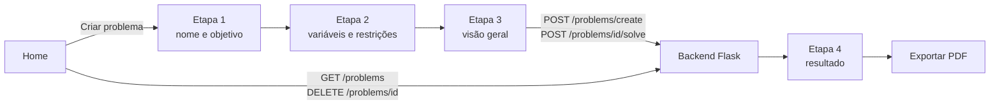

# Frontend

## Visão geral

O frontend é uma **Single Page Application (SPA)** em React. Ele oferece o
cadastro guiado do problema, a revisão dos dados, a chamada ao backend, a
visualização do resultado e a exportação do relatório em PDF.

O código fica em:

```text
frontend/
```

## Tecnologias

| Tecnologia | Uso no projeto |
|---|---|
| **React 19** | Componentes e estado da aplicação. |
| **Vite** | Servidor de desenvolvimento e build. |
| **Chakra UI v3** | Layout, formulários, diálogos, tabelas e toasts. |
| **React Router 7** | Navegação entre a Home e o cadastro. |
| **Axios** | Requisições HTTP para a API Flask. |
| **Recharts** | Gráfico de participação das variáveis no resultado. |
| **html2pdf.js** | Geração do relatório em PDF no navegador. |
| **React Icons** | Ícones da interface. |

As versões exatas estão em `frontend/package.json`.

## Como executar

```bash
cd frontend
npm install
npm run dev
```

Acesse <http://127.0.0.1:5173>. O backend precisa estar rodando em
<http://127.0.0.1:5000>. Veja [Como executar](como-executar.md).

### Scripts

| Comando | O que faz |
|---|---|
| `npm run dev` | Sobe o Vite em modo de desenvolvimento. |
| `npm run build` | Gera o build de produção em `dist/`. |
| `npm run preview` | Serve o build de produção localmente. |
| `npm run lint` | Executa o ESLint. |

## Estrutura do código

```text
src/
├── api.js                      # instância do Axios e URL da API
├── App.jsx                     # criação das rotas
├── main.jsx                    # bootstrap, Provider e Toaster
├── index.css                   # estilos globais
├── Paginas/
│   ├── RootLayout.jsx          # layout, fundo e cabeçalho
│   ├── Home.jsx                # lista, abertura e exclusão de problemas
│   ├── Problema.jsx            # fluxo guiado em quatro etapas
│   ├── TelaVisaoGeral.jsx      # revisão antes do cálculo
│   └── TelaResultado.jsx       # resultado, gráfico e exportação em PDF
├── componentes/
│   ├── Abas.jsx                # variáveis e restrições
│   ├── BotaoAjuda.jsx          # ajuda contextual
│   ├── Cabecalho.jsx           # cabeçalho da aplicação
│   ├── CardProblema.jsx        # card, modal de relatório e PDF
│   ├── CardRestricao.jsx       # item de restrição
│   ├── CardVariavel.jsx        # item de variável
│   └── GraficoPizza.jsx        # gráfico de participação
└── components/ui/              # snippets internos do Chakra UI
```

## Rotas

O React Router usa `createBrowserRouter` com duas rotas:

| Rota | Tela | Observação |
|---|---|---|
| `/` | `Home` | Lista os problemas salvos e permite excluir. |
| `/problem` | `Problema` | Cadastro guiado. O resultado aparece na etapa 4. |

Não existe rota separada para o resultado: ele é a última etapa do fluxo de
`/problem`. Ao recarregar a página, o estado do cadastro é perdido.

## Fluxo do usuário



### Etapa 1 — identificação

O usuário informa o nome do problema e escolhe **Maximização** ou
**Minimização**. O campo nome é obrigatório.

### Etapa 2 — variáveis e restrições

A tela `Abas` organiza duas etapas:

- **Variáveis:** nome, unidade de medida e coeficiente na função objetivo.
- **Restrições:** nome, operador (`<=`, `>=` ou `=`), limite e coeficientes
  vinculados a cada variável.

O botão **Vincular** associa um coeficiente a uma variável. Esse vínculo é
obrigatório para montar a lista de coeficientes na ordem correta.

!!! note "Não-negatividade"

    Ao adicionar uma variável, o frontend cria uma restrição visual de
    **não-negatividade**. Ela é apenas informativa: antes de enviar o problema,
    o frontend remove essas restrições e o backend aplica `lowBound=0` no PuLP.

### Etapa 3 — visão geral

`TelaVisaoGeral` mostra o nome, o objetivo, as variáveis e as restrições. Se
estiver tudo correto, o botão **Calcular** envia o problema ao backend.

### Etapa 4 — resultado

`TelaResultado` trata os status retornados pelo solver:

- `Optimal`: mostra a função objetivo, a tabela de quantidades, o lucro/custo
  ótimo, o gráfico e a análise das restrições.
- `Infeasible`: informa que as restrições são conflitantes.
- `Unbounded`: informa que falta uma restrição de escassez.
- Qualquer outro status: mostra uma mensagem genérica de erro.

## Estado da aplicação

O estado principal fica em `Problema.jsx`:

| Estado | Conteúdo |
|---|---|
| `etapa` | Etapa atual do fluxo (1 a 4). |
| `dados` | Nome e tipo do objetivo (`max` ou `min`). |
| `variaveis` | Lista de variáveis com IDs locais. |
| `restricoes` | Lista de restrições e coeficientes vinculados. |
| `resultado` | Resposta de `POST /problems/{id}/solve`. |
| `jsonPost` | Payload enviado ao backend, usado no relatório. |
| `carregando` | Controla o overlay de cálculo. |

Não há Redux, Zustand ou Context global. O estado é passado por props para
`Abas`, `TelaVisaoGeral` e `TelaResultado`.

## Integração com a API

As chamadas usam a instância `api` de `src/api.js`. A URL base vem de
`VITE_API_URL`; em desenvolvimento, o padrão é `http://127.0.0.1:5000`; no
build de produção, o padrão é a própria origem:

| Arquivo | Chamada |
|---|---|
| `Home.jsx` | `GET /problems` e `DELETE /problems/{id}`. |
| `Problema.jsx` | `POST /problems/create` e `POST /problems/{id}/solve`. |
| `CardProblema.jsx` | `GET /problems/{id}` e `GET /problems/{id}/result`. |

### Conversão do payload

O formulário usa nomes amigáveis (`max`, `min`) e o backend espera
`maximize`/`minimize`. A conversão acontece em `Problema.jsx`:

```js
const jsonFinal = {
  nome: dados.nome,
  objetivo: dados.tipo === "max" ? "maximize" : "minimize",
  variaveis: variaveis.map((v) => ({
    nome: v.nome,
    coeficiente_objetivo: Number(v.coeficiente_objetivo),
    unidade_medida: v.unidade_medida,
  })),
  restricoes: restricoesFormatadas,
};
```

Cada restrição envia `coeficientes` como uma **lista de números**, na mesma
ordem do array `variaveis`. O backend converte essa lista em registros ligados
aos IDs reais das variáveis. Veja o contrato completo em [API REST](api.md).

!!! info "Configuração local"

    Copie `frontend/.env.example` para `frontend/.env.local` e ajuste
    `VITE_API_URL` para apontar para outro backend. O arquivo `.env.local` é
    ignorado pelo Git.

## Relatório em PDF

O PDF é gerado **no navegador** com `html2pdf.js`:

- em `TelaResultado.jsx`, a partir do nó do resultado recém-calculado;
- em `CardProblema.jsx`, a partir do modal de um problema já salvo.

O elemento é capturado com `html2canvas` em escala 2 e convertido para A4 com
`jsPDF`. O arquivo é salvo como `relatorio-otimizacao-<nome>.pdf`.

Como o PDF é uma captura do DOM, ele depende do layout renderizado. Se o
relatório estiver carregando ou o navegador bloquear a operação, use o PDF de
backup da apresentação.

## Build e publicação

```bash
npm run build
```

O resultado fica em `dist/`, que é ignorado pelo Git. Para testar o build:

```bash
npm run preview
```

No container do projeto, o Flask serve o `dist/` e a API na mesma origem, então
não é necessário configurar `VITE_API_URL`. Para hospedar o frontend em um
servidor estático separado, gere o build com `VITE_API_URL` apontando para o
backend público. O Flask de desenvolvimento não deve ser exposto diretamente em
produção; o container usa Waitress como servidor WSGI.

## Limitações e próximos passos

- Sem autenticação e sem separação de usuários.
- Sem edição de problema: o fluxo é criar, resolver e excluir.
- Sem rota para visualizar um resultado antigo diretamente por URL.
- Sem testes automatizados de componentes.
- O estado é perdido ao recarregar `/problem`.
- O PDF depende da renderização do navegador.
- O bundle de produção passa de 2 MB; o Vite emite um aviso de chunk grande.

Melhorias naturais: adicionar testes com Vitest, dividir o bundle com imports
dinâmicos e criar uma rota `/problems/:id` para compartilhar resultados.
