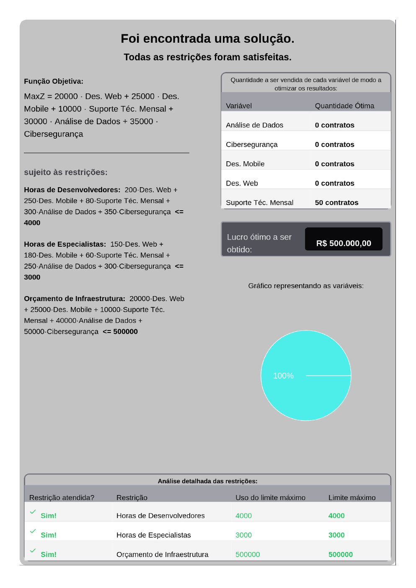

# Technopti

Sistema web para **modelagem e resolução de problemas de Programação Linear**.
O usuário cadastra variáveis e restrições em um fluxo guiado; o backend monta o
modelo matemático, resolve com PuLP/CBC e devolve o resultado com relatório em PDF.

[Apresentação solo](apresentacao.md){ .md-button .md-button--primary }
[Como executar](como-executar.md){ .md-button }
[Modelo matemático](modelo-matematico.md){ .md-button }

## Acesso rápido

-   :material-presentation:{ .lg .middle } **Apresentação**

    ---

    Roteiro solo de **5 a 7 minutos**, PDF de 5 páginas A4, checklist, plano B e blocos para o exercício, o Solver da planilha e o cronograma.

    [:octicons-arrow-right-24: Abrir apresentação](apresentacao.md)

-   :material-rocket-launch:{ .lg .middle } **Como executar**

    ---

    Suba backend e frontend com um comando no Linux, macOS ou Windows, ou siga o passo a passo manual.

    [:octicons-arrow-right-24: Ver comandos](como-executar.md)

-   :material-monitor:{ .lg .middle } **Frontend**

    ---

    React 19, Vite, Chakra UI e o fluxo de quatro etapas até o resultado.

    [:octicons-arrow-right-24: Ver frontend](frontend.md)

-   :material-database:{ .lg .middle } **Backend e banco**

    ---

    Flask, SQLAlchemy, SQLite, PuLP/CBC e o ciclo de vida de cada requisição.

    [:octicons-arrow-right-24: Ver backend](backend.md)

-   :material-api:{ .lg .middle } **API REST**

    ---

    Endpoints para criar, listar, resolver, consultar resultado e excluir problemas.

    [:octicons-arrow-right-24: Consultar API](api.md)

-   :material-file-pdf-box:{ .lg .middle } **Documentação em PDF**

    ---

    Documentação técnica, roteiro e relatório oficial para consulta offline.

    [:octicons-arrow-right-24: Abrir PDFs](documentacao-pdf.md)

-   :material-book-open-variant:{ .lg .middle } **Documentação (MkDocs)**

    ---

    Como editar, servir, validar e publicar este site com MkDocs Material.

    [:octicons-arrow-right-24: Ver fluxo do MkDocs](mkdocs.md)

## Situação atual da demonstração

!!! success "Ambiente pronto"

    - **Frontend:** <http://127.0.0.1:5173>
    - **Backend:** <http://127.0.0.1:5000/problems>
    - **Documentação:** <http://127.0.0.1:8000>
    - **Banco:** problema oficial **“Maximização da Empresa de TI”** com resultado salvo.
    - **Relatório oficial:** 50 contratos de Suporte Técnico Mensal; lucro de **R$ 500.000**.

| Item | Valor |
|---|---:|
| Problemas no banco | 1 |
| Variáveis de decisão | 5 |
| Restrições | 3 |
| Coeficientes de restrição | 15 |
| Resultados salvos | 1 |

## Resultado oficial

O modelo oficial escolhe **50 contratos de Suporte Técnico Mensal** e não utiliza
os demais serviços. As três restrições ficam exatamente no limite:

| Restrição | Uso | Limite | Folga |
|---|---:|---:|---:|
| Horas de Desenvolvedores | 4.000 | 4.000 | 0 |
| Horas de Especialistas | 3.000 | 3.000 | 0 |
| Orçamento de Infraestrutura | R$ 500.000 | R$ 500.000 | 0 |

O motivo é o retorno por hora escassa: **R$ 125/h** de desenvolvimento para o
Suporte Técnico Mensal, contra **R$ 100/h** dos demais serviços.

{ loading=lazy }

## Tecnologias

| Camada | Tecnologias |
|---|---|
| Frontend | React 19, Vite, Chakra UI, Axios, Recharts, html2pdf.js |
| Backend | Python, Flask, Flask-CORS, SQLAlchemy |
| Otimização | PuLP com solver CBC |
| Banco | SQLite |
| Documentação | MkDocs Material |

## Documentação do projeto

- [Apresentação solo](apresentacao.md) — arquivos oficiais e roteiro.
- [Roteiro em texto](roteiro-apresentacao.md) — roteiro completo para editar.
- [Documentação em PDF](documentacao-pdf.md) — PDFs e materiais para download.
- [Projeto](projeto.md) — contexto, arquitetura e fluxo funcional.
- [Como executar](como-executar.md) — scripts, comandos e solução de problemas.
- [Frontend](frontend.md) — telas, componentes, estado e integração com a API.
- [Backend e banco](backend.md) — rotas, modelos, sessão e solver.
- [API REST](api.md) — contrato, exemplos e códigos de erro.
- [Modelo matemático](modelo-matematico.md) — formulação e resultados.
- [Estrutura](estrutura.md) — pastas, banco e o que é versionado.
- [Documentação (MkDocs)](mkdocs.md) — como manter e publicar este site.
- [FAQ](faq.md) — perguntas prováveis da apresentação.
