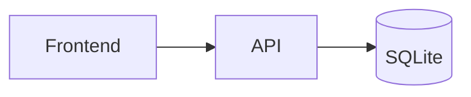

# Documentação com MkDocs

## Visão geral

A documentação do Technopti é um site estático gerado com **MkDocs** e o tema
**Material for MkDocs**. O conteúdo fica em `docs/`, a configuração em
`mkdocs.yml` e o site gerado em `site/`.

```text
TechnoPTI/
├── mkdocs.yml              # configuração do site e da navegação
├── requirements-docs.txt   # versão do MkDocs Material
├── scripts/
│   ├── iniciar-docs.sh     # servidor local com recarga automática
│   ├── gerar-docs.sh       # build estático com --strict
│   ├── parar-docs.sh       # encerra o servidor na porta 8000
│   └── windows/            # equivalentes em PowerShell
└── docs/
    ├── index.md
    ├── apresentacao.md
    ├── roteiro-apresentacao.md
    ├── documentacao-pdf.md
    ├── projeto.md
    ├── como-executar.md
    ├── frontend.md
    ├── backend.md
    ├── api.md
    ├── modelo-matematico.md
    ├── estrutura.md
    ├── mkdocs.md
    ├── ci-cd.md
    ├── faq.md
    ├── assets/
    │   ├── materiais/
    │   ├── arquivo/
    │   └── img/
    └── stylesheets/extra.css
```

!!! info "Site gerado não é versionado"

    A pasta `site/` é criada pelo MkDocs e está no `.gitignore`. O que vai para
    o GitHub é o conteúdo-fonte em `docs/` e a configuração `mkdocs.yml`.

## Comandos

### Servir localmente

```bash
./scripts/iniciar-docs.sh
```

Acesse <http://127.0.0.1:8000>. O servidor recarrega a página quando um arquivo
de `docs/` ou o `mkdocs.yml` muda.

Para encerrar:

```bash
./scripts/parar-docs.sh
```

### Windows (PowerShell)

Os mesmos comandos estão disponíveis em `scripts/windows/`:

```powershell
powershell -ExecutionPolicy Bypass -File .\scripts\windows\iniciar-docs.ps1
powershell -ExecutionPolicy Bypass -File .\scripts\windows\gerar-docs.ps1
powershell -ExecutionPolicy Bypass -File .\scripts\windows\parar-docs.ps1
```

### Gerar o site estático

```bash
./scripts/gerar-docs.sh
```

O script executa:

```bash
.mkdocs-venv/bin/mkdocs build --clean --strict
```

O resultado fica em `site/index.html`. O modo `--strict` transforma avisos de
links quebrados e páginas ausentes em erro de build, garantindo que o site
publicado não tenha links órfãos.

### Instalação manual

Linux/macOS:

```bash
python3 -m venv .mkdocs-venv
source .mkdocs-venv/bin/activate
python -m pip install -r requirements-docs.txt
mkdocs serve -a 127.0.0.1:8000
```

Windows (PowerShell):

```powershell
py -m venv .mkdocs-venv
.\.mkdocs-venv\Scripts\Activate.ps1
python -m pip install -r requirements-docs.txt
python -m mkdocs serve -a 127.0.0.1:8000
```

Para gerar sem os scripts:

```bash
# Linux/macOS
.mkdocs-venv/bin/mkdocs build --clean --strict
```

```powershell
# Windows
.\.mkdocs-venv\Scripts\python.exe -m mkdocs build --clean --strict
```

### Limpar o build

```bash
rm -rf site/
```

O próximo `./scripts/gerar-docs.sh` recria a pasta.

## Navegação

A ordem do menu lateral é definida em `mkdocs.yml`:

```yaml
nav:
  - Início: index.md
  - Apresentação:
      - Visão geral: apresentacao.md
      - Roteiro em texto: roteiro-apresentacao.md
  - Documentação em PDF: documentacao-pdf.md
  - Projeto: projeto.md
  - Como executar: como-executar.md
  - Frontend: frontend.md
  - Backend e banco: backend.md
  - API REST: api.md
  - Modelo matemático: modelo-matematico.md
  - Estrutura: estrutura.md
  - Documentação (MkDocs): mkdocs.md
  - CI/CD e release: ci-cd.md
  - FAQ: faq.md
```

Cada item aponta para um arquivo dentro de `docs/`. O título à esquerda dos
dois-pontos é o texto exibido no menu.

## Como adicionar uma página

1. Crie o arquivo em `docs/`, por exemplo `docs/testes.md`.
2. Comece com um título `# Testes`.
3. Adicione o item em `nav` no `mkdocs.yml`.
4. Use links relativos entre páginas: `[API](api.md)`.
5. Rode `./scripts/gerar-docs.sh` para validar.

```markdown
# Testes

Conteúdo da página.

Veja também [Como executar](como-executar.md).
```

!!! tip "Links internos"

    Use o caminho do arquivo `.md`, não a URL final. O MkDocs converte
    `api.md` em `/api/` automaticamente. Evite links absolutos como
    `http://127.0.0.1:8000/api/`, que quebram no site publicado.

## Imagens e arquivos

Coloque imagens em `docs/assets/img/` e referencie com caminho relativo:

```markdown

```

Para arquivos para download, use `docs/assets/materiais/`:

```markdown
[Baixar roteiro](assets/materiais/ROTEIRO-APRESENTACAO-TECHNOPTI.pdf)
```

O MkDocs copia `docs/assets/` para o site. PDFs, planilhas e documentos também
podem ser baixados pelo navegador. A página
[Documentação em PDF](documentacao-pdf.md) usa esse diretório para reunir os
materiais oficiais.

## Recursos de Markdown

### Admonições

```markdown
!!! note "Título"
    Texto da nota.

!!! warning "Atenção"
    Texto do aviso.
```

### Diagramas Mermaid

````markdown

````

### Abas

````markdown
=== "Backend"

    ```bash
    python app.py
    ```

=== "Frontend"

    ```bash
    npm run dev
    ```
````

### Blocos de código

Use três crases com a linguagem para ativar o realce e o botão de copiar:

````markdown
```bash
curl http://127.0.0.1:5000/problems
```
````

## Configuração do tema

O `mkdocs.yml` define:

- **Material** como tema, com idioma `pt-BR`;
- logo e favicon em `docs/assets/img/logo.svg`;
- paleta clara e escura;
- navegação por seções, botão “voltar ao topo” e rodapé;
- busca com sugestões e destaque;
- botão de copiar código e abas sincronizadas;
- extensões de admonição, tabelas, Mermaid, emojis e destaque de código.

O rodapé é configurado por `copyright`. Para exibir um link para o GitHub no
tema, defina também `repo_url` e `repo_name`.

## Build estrito e problemas comuns

| Sintoma | Causa provável | Solução |
|---|---|---|
| `mkdocs: command not found` | Venv não ativado. | Use `./scripts/iniciar-docs.sh` ou ative `.mkdocs-venv`. |
| `Address already in use` na porta 8000 | Servidor antigo. | `./scripts/parar-docs.sh` ou `fuser -k 8000/tcp`. |
| `WARNING - Doc file ... contains a link to ... which is not found` | Link relativo errado. | Corrija o caminho ou crie o arquivo. |
| Build passa, mas página não aparece no menu | Falta item em `nav`. | Adicione o arquivo ao `nav`. |
| Site antigo após editar | Cache do navegador ou build antigo. | Recarregue com `Ctrl+F5` e rode `./scripts/gerar-docs.sh`. |

!!! note "Aviso do Material sobre o MkDocs 2.0"

    O Material exibe um aviso informativo sobre a futura versão 2.0 do MkDocs.
    Esse aviso não impede o build e não é um erro do projeto. A versão usada
    está fixada em `requirements-docs.txt`.

## Publicação no GitHub Pages

Com o repositório configurado e autenticado, gere e publique a branch
`gh-pages`:

```bash
./scripts/gerar-docs.sh
.mkdocs-venv/bin/mkdocs gh-deploy --clean
```

Depois, no GitHub:

1. abra **Settings → Pages**;
2. escolha **Deploy from a branch**;
3. selecione a branch `gh-pages` e a pasta `/ (root)`;
4. salve e aguarde a URL publicada.

O endereço fica no formato:

```text
https://<usuario>.github.io/<repositorio>/
```

!!! warning "URL da API no site publicado"

    O site da documentação é estático, mas o frontend continua chamando
    `http://127.0.0.1:5000`. Para uma demonstração pública, o backend precisa
    estar hospedado em outro endereço e a URL da API deve ser ajustada no
    frontend. Veja [Frontend](frontend.md#build-e-publicacao).

## Checklist antes de publicar

- [ ] `./scripts/gerar-docs.sh` termina sem erros.
- [ ] Todos os links internos abrem.
- [ ] A página nova está no `nav`.
- [ ] Imagens e PDFs existem em `docs/assets/`.
- [ ] O site foi testado em `http://127.0.0.1:8000`.
- [ ] `site/` e `.mkdocs-venv/` continuam fora do Git.
- [ ] O `README.md` aponta para a documentação correta.
