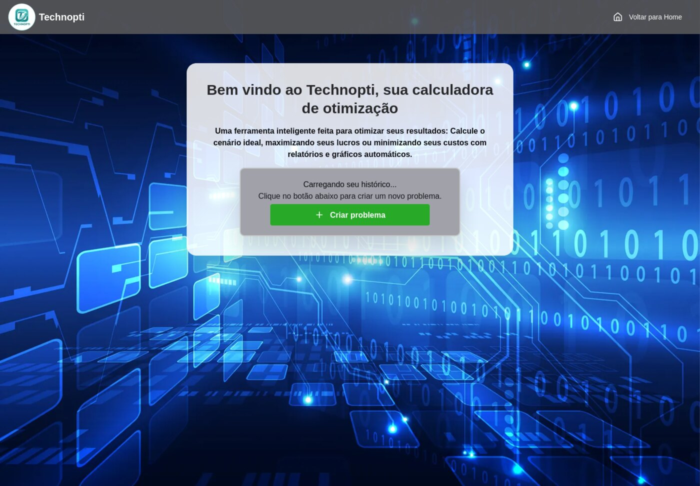
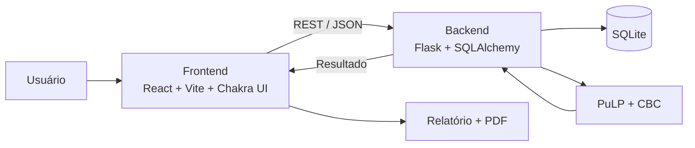

# Projeto

## Visão geral

O **Technopti** é uma aplicação web para modelagem e resolução de problemas de
**Programação Linear**. A proposta é substituir o processo manual em planilhas
por um fluxo guiado, com validação, persistência e geração automática de relatório.

O sistema permite:

- cadastrar um problema de maximização ou minimização;
- definir variáveis de decisão, coeficientes e unidades;
- montar restrições com coeficientes por variável;
- resolver o modelo com PuLP/CBC;
- visualizar a solução ótima, o uso das restrições e a folga;
- exportar o relatório em PDF.

{ loading=lazy }

## Problema motivador

Empresas tomam decisões de alocação de recursos em planilhas. Isso gera:

- erros de fórmula e de referência;
- retrabalho para montar e conferir o modelo;
- falta de rastreabilidade das decisões;
- dificuldade para comparar cenários;
- pouca clareza na comunicação do resultado.

O Technopti organiza esse processo em uma aplicação com banco de dados, API REST
e solver matemático.

## Estudo de caso

O problema oficial é uma empresa de TI com cinco serviços:

| Serviço | Lucro unitário | Horas de desenvolvimento | Horas de especialistas | Infraestrutura |
|---|---:|---:|---:|---:|
| Desenvolvimento Web | R$ 20.000 | 200 | 150 | R$ 20.000 |
| Desenvolvimento Mobile | R$ 25.000 | 250 | 180 | R$ 25.000 |
| Suporte Técnico Mensal | R$ 10.000 | 80 | 60 | R$ 10.000 |
| Análise de Dados | R$ 30.000 | 300 | 250 | R$ 40.000 |
| Cibersegurança | R$ 35.000 | 350 | 300 | R$ 50.000 |

**Recursos disponíveis:** 4.000 horas de desenvolvimento, 3.000 horas de
especialistas e R$ 500.000 de infraestrutura.

**Objetivo:** decidir quantos contratos de cada serviço fechar para maximizar o lucro.

## Arquitetura

### Frontend

- **React 19** com **Vite**.
- **Chakra UI v3** para componentes e layout.
- **Axios** para chamadas à API.
- **Recharts** para o gráfico de participação das variáveis.
- **html2pdf.js** para exportar o relatório em PDF.

O fluxo de telas, os componentes e a integração com a API estão em
[Frontend](frontend.md).

### Backend

- **Flask** com blueprints para problemas e resultados.
- **Flask-CORS** para permitir o acesso do frontend.
- **SQLAlchemy** para persistência.
- **PuLP** com o solver **CBC** para resolver o modelo.
- **SQLite** como banco local.

As rotas, os modelos, a sessão por thread e o solver estão em
[Backend e banco](backend.md).

### Banco

Cinco tabelas guardam o problema, as variáveis, as restrições, os coeficientes e
os resultados. Veja o detalhamento em [Estrutura](estrutura.md#banco-de-dados).

## Fluxo funcional

1. O usuário cria um problema e escolhe **maximizar** ou **minimizar**.
2. Cadastra as variáveis de decisão e seus coeficientes na função objetivo.
3. Cadastra as restrições e vincula cada coeficiente às variáveis.
4. O frontend envia o problema completo para `POST /problems/create`.
5. Ao calcular, o backend monta o modelo PuLP e chama o CBC.
6. O resultado é salvo e devolvido com status, valor ótimo, variáveis e restrições.
7. O frontend mostra a tabela, o gráfico e o relatório.
8. O usuário pode exportar o relatório em PDF.

## Diferenciais

- **Fluxo guiado:** abas e cards organizam variáveis e restrições.
- **Validação:** o backend verifica campos obrigatórios, operadores e quantidade de coeficientes.
- **Rastreabilidade:** problemas, variáveis, restrições e resultados ficam no banco.
- **Feedback visual:** uso e folga de cada restrição são exibidos no relatório.
- **Relatório:** o PDF é gerado a partir do próprio relatório renderizado.
- **Didático:** o sistema mostra a função objetivo e as restrições em formato matemático.

## Documentação

A documentação técnica é um site MkDocs Material:

- [Frontend](frontend.md) — React, telas, estado e PDF.
- [Backend e banco](backend.md) — Flask, SQLAlchemy, SQLite e PuLP/CBC.
- [API REST](api.md) — contrato dos endpoints.
- [Documentação (MkDocs)](mkdocs.md) — como servir, validar e publicar.
- [Estrutura](estrutura.md) — árvore do repositório e schema do banco.

## Limitações atuais

- Não há autenticação de usuários.
- Cada problema possui um único objetivo.
- As variáveis são contínuas; não há programação inteira.
- O banco é local (SQLite).
- O backend usa o servidor de desenvolvimento do Flask.
